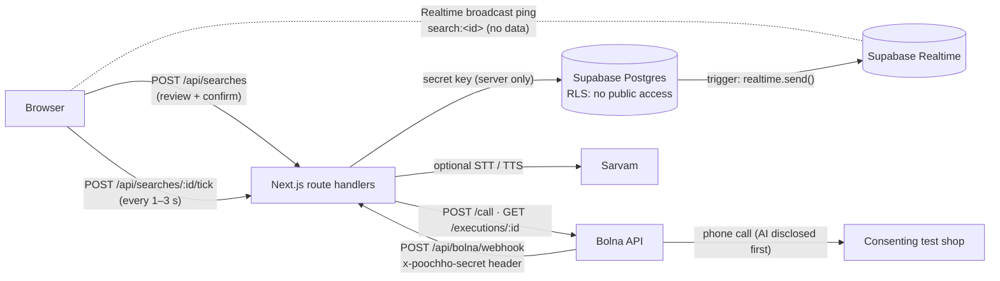

# Poochho · पूछो

**India's shops have no inventory API. The phone is the API. Poochho calls for you.**

You say what you need ("2 packets of Amul Butter, near Kothrud"). Poochho calls several local shops at the same time
through a Bolna voice agent, asks about stock, price and whether they can hold it, then ranks the verified answers.
It also gives a spoken summary in Hindi or English. One tap places a separate call asking the best shop to keep it
for you.

**Availability first, and every answer has proof.** Packaged goods and medicines carry a printed MRP, so prices barely
differ between shops; what matters is who has it now, how soon it's ready and whether they'll hold it. Results lead
with that, price second. Every answer shows the shopkeeper's own words (checked word for word against the call
transcript, never paraphrased), how fresh it is ("confirmed 6 min ago"), and what the calls cost (from Bolna's own
per-call charge). The operator can play back the recording of a real call.

Built for the Bolna Buildathon. Next.js 16 (App Router), React 19, TypeScript, Tailwind 4, Supabase Postgres + Realtime,
Bolna, optional Sarvam speech. **No LLM decides anything**: validation, ranking, explanations and summaries are
deterministic code. The voice calls and post-call extraction run on Bolna.

**Speak in any of 11 Indian languages** (with `SARVAM_API_KEY`). Say "मला कोथरूड, पुणे मध्ये दोन पॅकेट अमूल बटर हवे आहे"
and Sarvam detects Marathi, transcribes it (`saaras:v4`), and `sarvam-105b-conversations` fills the whole form:
product, quantity, unit, category, city and area. The model's output is reduced to known fields and enum values, and
you review every field before anything is called. Afterwards, hear the summary in Hindi, English, Marathi, Bengali,
Tamil, Telugu, Kannada, Malayalam, Gujarati, Punjabi or Odia: Sarvam Translate plus Bulbul, labelled
machine-translated. Shops are still called in Hindi or English.

## Modes

| Mode | What happens | Phones ring? |
|---|---|---|
| **SIMULATED** (default) | Scripted calls to fictional demo shops, in Bolna's exact payload shape, through the real pipeline (DB, state machine, Realtime, ranking) | No |
| **LIVE** | Real Bolna calls to consenting test shops. Locked unless configured; needs the operator token and an explicit confirmation | Yes |
| **REPLAY** | Plays back a saved, sanitised run on its recorded timeline. Labelled with its source (real or simulated) | No |

The three modes never look alike: hatched marigold, red with a pulsing dot, and indigo banners, plus per-card tags.

## Architecture



- **State lives in Postgres**, not in a server process, so it is safe on serverless. Progress is driven by the
  `tick` endpoint (idempotent, safe from several tabs) and by Bolna webhooks. `tick` delivers due scripted steps,
  dispatches queued live calls, polls Bolna as a webhook fallback, and runs a watchdog.
- **One state machine for all modes.** Webhooks, polls and scripted steps all become the same normalised event and
  go through `mergeEvent` (`lib/state.ts`):
  - Status only moves forward: `queued → dispatching → ringing → talking → processing → done | failed`.
  - `done` and `failed` are final.
  - The app's own `timeout` yields only to a real provider outcome.
  - Transcripts and durations only grow.
  - Duplicates are no-ops.
  - Merges use optimistic concurrency (a `version` column), so concurrent webhooks cannot lose updates.
- **No double dialling.** `claim_live_calls()` (SQL, advisory lock) claims queued calls atomically and never
  exceeds `MAX_CONCURRENCY` in flight; recent timeouts still count as in flight. Calls left queued for more than
  10 minutes expire rather than dial late.
- **Checks at dial time.** Turning LIVE off, the calling window, consent and opt-out are all re-checked right
  before dialling. A call Bolna accepted is never marked failed: if its id can't be stored, the webhook is matched
  through the id we send in `user_data`. Bolna is never asked to retry, and calls it reschedules are stopped.
- **Realtime without exposing data.** The tables are closed to the publishable key. A trigger broadcasts
  `{execution_id, status}` on a per-search public channel, and the browser refetches through the API. The tick
  response doubles as a polling fallback.
- **Proof behind every answer.** Bolna's `stock_quote` extraction returns the shopkeeper's words about availability.
  The server shows a quote only if it appears word for word in one of the shopkeeper's own turns of the transcript
  (`quoteHeard` in `lib/extraction.ts`), so a paraphrase or an invented line never reaches the screen. Freshness comes
  from when the call ended. Recordings of LIVE calls are fetched from Bolna at play time and streamed to the operator
  (`/api/executions/[id]/recording`); the 24-hour link is never stored.

Key files:

- **`lib/`**
  - `engine.ts`: orchestration and DB
  - `state.ts`: state machine
  - `extraction.ts`: Bolna extraction parser
  - `rank.ts`: scoring
  - `summary.ts`: spoken and share text
  - `sim.ts`: simulated calls
  - `bolna.ts`, `sarvam.ts`: provider clients
  - `validate.ts`, `voice.ts`, `metrics.ts`, `config.ts`
- **`components/`**: the UI
- **`app/api/*`**: route handlers
- **`supabase/migrations/`**: schema

## Run it locally

Requires Node 22+ (tested on 22.22) and a Supabase project.

```bash
npm install
cp .env.example .env.local       # fill in the Supabase values (see below)
# apply the migrations (see "Database"), then:
npm run dev                      # http://localhost:3000
```

SIMULATED and REPLAY work with only the Supabase variables. To enable LIVE calls, see
[docs/bolna-setup.md](docs/bolna-setup.md).

### Environment variables

| Variable | Needed for | Notes |
|---|---|---|
| `NEXT_PUBLIC_SUPABASE_URL` | all | Project URL |
| `NEXT_PUBLIC_SUPABASE_PUBLISHABLE_KEY` | all | Browser key; used only for Realtime pings (it can read no table) |
| `SUPABASE_SECRET_KEY` | all | **Server only.** Bypasses RLS. Never prefix with `NEXT_PUBLIC_` |
| `BOLNA_API_KEY`, `BOLNA_AGENT_ID` | LIVE | `BOLNA_HOLD_AGENT_ID` optional (defaults to the main agent) |
| `BOLNA_FROM_NUMBER` | optional | Caller ID from your Bolna account |
| `BOLNA_WEBHOOK_SECRET` | LIVE | Sent by Bolna in the `x-poochho-secret` header (header only, never in the URL) |
| `BOLNA_WEBHOOK_IPS` | optional | Source-IP allowlist |
| `LIVE_CALLS_ENABLED` | LIVE | Must be `true`. Default `false` |
| `POOCHHO_ADMIN_TOKEN` | LIVE, labels, export | Operator token (12+ chars) |
| `MAX_CALLS_PER_REQUEST` | | Default 5 (max 8) |
| `MAX_CONCURRENCY` | | Default 8. Use 2 on a Bolna trial |
| `MAX_LIVE_CALLS_PER_DAY` | | Default 25 |
| `CALL_WINDOW_IST` | | Default `09:00-20:00` |
| `CALL_WATCHDOG_SECONDS` | | Default 300 (minimum 120), measured from the last call milestone |
| `SARVAM_API_KEY` | optional | Sarvam STT (`saaras:v4`, language auto-detected), form filling (`sarvam-105b-conversations`), translation (`sarvam-translate:v1`) and TTS (`bulbul:v3`). Without it the browser's speech APIs are used (Hindi/English only) |

## Database

Four migrations in `supabase/migrations/`:

- **`20261016000000_init.sql`**: 5 tables, RLS, grants, triggers.
- **`20261016010000_claim_live_calls.sql`**: the atomic dispatch function.
- **`20261016020000_review_fixes.sql`**: an opt-out trigger that records an opt-out in the same write as the
  call update; queue expiry; timeouts counted in concurrency.
- **`20261016030000_call_cost.sql`**: `call_executions.cost_cents`, what Bolna charged per call in US cents.

Tables:

- **`shops`**: consent and opt-out live here; `phone` is unique, so an opt-out covers the number.
- **`search_requests`**
- **`call_executions`**: one row per call, holds included.
- **`call_events`**: a sanitised log of every webhook, poll and scripted step.
- **`result_labels`**: manual ground truth.

Apply them with either:

- **Supabase SQL editor:** paste each file in order and run it. This is how the project's database was set up on
  2026-10-16.
- **CLI:** `npx supabase db push --db-url "postgresql://postgres:<password>@db.<ref>.supabase.co:5432/postgres"`.
  The CLI records versions in `supabase_migrations.schema_migrations`. If you applied the files by hand, don't
  re-push them.

**Security model.**

- RLS is on with no policies, and table grants are revoked from `anon` and `authenticated`. The publishable key
  gets `42501 permission denied` everywhere.
- There are no user accounts. A search is readable by whoever holds its unguessable URL. The search API never
  returns phone numbers.
- For LIVE searches, transcripts, the shopkeeper's quoted words, free-text notes, raw provider errors and Bolna's call
  id are returned only with the operator token. The call id matters: Bolna's recording endpoint
  (`/recordings/call/{id}`) answers without authentication. Simulated and replayed calls are fictional and shown in
  full.
- Call recordings (LIVE only) are operator-only, fetched from Bolna when played and streamed through; the link is
  never stored, and `call_events` keeps no recording links.
- Labels and exports are operator-only.
- Sarvam STT needs the operator token. Sarvam TTS only speaks the server-computed summary of an existing
  search, so neither can be used as an open proxy on your key.

**Retention.** Data stays until you delete it. Delete everything older than 30 days with:

```sql
delete from public.search_requests where created_at < now() - interval '30 days'; -- cascades to calls, events, labels
```

Opt-outs live on `shops` and are deliberately **not** deleted.

## Ranking (deterministic, `lib/rank.ts`)

`score = (stock + readiness + hold + price) × confidence`

Availability leads: packaged goods and medicines carry a printed MRP (selling above it is illegal), so price gaps
between shops are small. To go back to price-led ranking, change `WEIGHTS` in `lib/rank.ts`.

| Factor | Points |
|---|---|
| Stock | 50 for the full quantity; up to 20 for partial stock; 0 otherwise |
| Readiness | 20 if ready now, falling linearly to 0 at two hours. Unknown scores 0 |
| Hold | 15 if the shop says it can hold the item |
| Price | 15 × (cheapest verified unit price ÷ this unit price). A stated total sets the unit price (total ÷ quantity). Unknown price scores 0 |
| Confidence | high × 1.0, medium × 0.85, low × 0.6 (from Bolna's extraction confidence labels) |

Rules:

- Only a shop with the **full quantity**, within budget and deadline, can be the best match.
- Unknown prices are never treated as zero or as cheapest. Prices quoted for a different unit are not compared.
- Ties go to the lower total, then faster readiness, higher confidence, then name.
- Explanations, the spoken summary and the WhatsApp text say has it / ready in / can hold first, then the price.
  They use templates filled only with extracted values.
- A reservation shows as confirmed only when the shop agreed on the separate hold call.

## Scripts

| Command | What it does |
|---|---|
| `npm run dev` / `build` / `start` | Next.js |
| `npm test` | 70 unit tests (validation, extraction and the quote check, state machine, ranking, summaries, voice parsing, metrics/CSV and cost, Bolna payload parsing, webhook and recording routes with mocked dependencies) |
| `npm run test:integration` | 16 tests on the real Supabase. Persistence, concurrent ticks, duplicate and out-of-order events, opt-out trigger, holds, Realtime delivery, RLS denial. Against a **mocked** Bolna: LIVE dispatch, concurrency under racing dispatchers, polling fallback, no auto-retry, kill switch, queue expiry, refused vs unconfirmed calls, webhook adoption, transcript redaction. No call is ever placed |
| `npm run typecheck`, `npm run lint` | tsc and eslint |
| `npm run check:secrets` | After `build`: fails if a server secret appears in the browser bundle or in tracked files |
| `npm run seed:shops` | Upserts consenting test shops from `data/shops.local.json` (gitignored) |
| `npm run replay:export -- <search_id> ["Title"]` | Saves a finished run as a sanitised replay in `data/replays.json` |
| `npm run bolna -- check \| setup-extractions --yes \| test-extraction` | Bolna account check, extraction setup (creates only the ones missing from the agent), and an extraction test without a call |

## Deploy (Vercel)

1. Import the GitHub repo into Vercel. Set the environment variables (secrets as encrypted variables, never
   `NEXT_PUBLIC_`).
2. `vercel.json` pins functions to `icn1` (Seoul), next to the Supabase database (ap-northeast-2).
3. Set the Bolna webhook to `https://<deployment>/api/bolna/webhook` with the `x-poochho-secret` header.
4. Keep `LIVE_CALLS_ENABLED=false` on any public deployment unless you are running a supervised live test.

## Troubleshooting

| Symptom | Fix |
|---|---|
| "Supabase is not configured" | Set the three Supabase variables and restart |
| `42501 permission denied` from the server | Grants missing: re-run the init migration (new Supabase projects need explicit grants) |
| Live mode is greyed out | The home page lists what is missing (flag, keys, token, webhook secret) or says you're outside the calling window |
| Calls stay "Dialling" | Bolna queues calls beyond your concurrency limit (trial = 2). Check `npm run bolna -- check` |
| Webhook "Send test" returns 401 | The `x-poochho-secret` header value does not match `BOLNA_WEBHOOK_SECRET` |
| No live updates locally | Expected: Bolna can't reach localhost. The page polls Bolna every 5 s while open |
| "Realtime connected" never shows | Realtime broadcast is optional. The tick keeps the page updating. Check the project's Realtime settings allow public channels |
| `X is not a function` in dev after editing `lib/` | Stale dev-server module. Restart `npm run dev` |
| Spoken summary is silent | Sarvam not configured and the browser has no Hindi voice. The text summary is always shown |

## Known limitations

- No user accounts: anyone with the URL can view a search, and SIMULATED searches are not rate-limited. Fine for a
  supervised demo; add auth before a public launch.
- The live calling path (Bolna `POST /call`, webhooks, polling, extraction) is implemented to Bolna's documented
  API and tested against a mocked Bolna only. No real call was made while building it. See `BUILD_REPORT.md`.
- Sarvam STT, form filling, translation and TTS were verified against the live API on 2026-10-16 (Marathi and
  Tamil). The browser speech fallback depends on the browser.
- Shop discovery via Google Places is not implemented. Only consenting test shops can be called.
- Hindi strings were written by the developer and need review by a native speaker.
